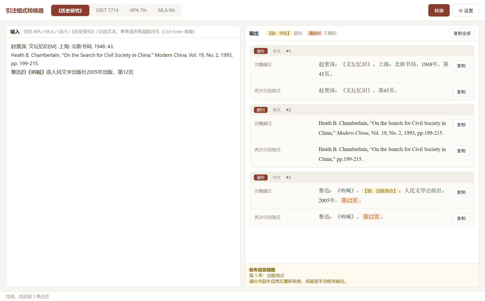

# 引注格式转换器

写论文时，参考文献的格式往往比找材料还磨人：同一本书，知网导出是一种写法，《历史研究》要求另一种写法，投英文期刊又要换成 APA。这个软件做的就是这件事——把一条文献信息粘贴进去，选好目标格式，直接得到可以复制进论文的引注。



## 它能帮你做什么

- 把 APA、MLA、GB/T 7714、《历史研究》、知网导出、百度学术，甚至随手写的一句“鲁迅的《呐喊》由人民文学出版社2005年出版，第12页”，转成规范的引注。
- 一次可以粘贴很多条，软件会自动拆开，不必一条一条处理。
- 同时给出完整脚注、参考文献条目、文内引用和再次引用简式。
- 缺了出版地、出版年、页码之类的信息，会用醒目的 `【缺：出版地】` 标出来，提醒你回去补。
- 拿不准的字段会标成“请核对”，避免把软件的猜测直接写进定稿。
- 中英文文献都支持，日文文献也能按日文规则处理。

例如把下面这条知网式著录：

```
赵景深. 文坛忆旧[M]. 上海: 北新书局, 1948: 43.
```

转换成《历史研究》格式后，会得到：

```
赵景深：《文坛忆旧》，上海：北新书局，1948年，第43页。
```

## 下载与安装

目前提供 Windows 便携版，不需要安装，也不需要提前装 Python、Node 或其他开发环境：

1. 打开 [Releases 页面](https://github.com/kaneliers/citation-converter/releases/latest)。
2. 下载文件名以 `citation-converter` 开头、以 `portable.exe` 结尾的文件（当前版本为 1.0.0）。
3. 双击运行即可。可以把它放在任意文件夹，也可以发送快捷方式到桌面。

第一次运行时，Windows 可能弹出“已保护你的电脑”。点击“更多信息”，再点“仍要运行”即可。

## 第一次使用：填一个 AI 接口

软件需要借助在线的 AI 服务来读懂各种写法的文献信息。这个服务不是软件自带的，需要你用自己的账号接入，按实际用量向服务商付费；普通论文写作的用量通常很少。

以 DeepSeek 为例：

1. 打开 [DeepSeek 开放平台](https://platform.deepseek.com/)，注册并创建一个 API Key，复制下来。
2. 打开软件，点右上角的「设置」。
3. 在“接口预设”里选 DeepSeek，接口地址和模型名称会自动填好。
4. 把 API Key 粘贴到对应输入框，点“测试连接”。显示“连接成功”后保存。

也可以改用 Kimi、通义千问或 OpenAI，在预设里切换即可。API Key 只保存在你自己的电脑上。

## 三步完成一次转换

1. **粘贴**：把文献信息贴到左边，一条或多条都行，格式不必统一。
2. **选格式**：在顶部选择你要投的刊物或论文要求的格式。
3. **转换**：点“转换”，或按 `Ctrl+Enter`。右边出现结果后，逐条点“复制”，或者点右上角“复制全部”。

切换顶部格式标签时，已经识别出的条目会立刻按新格式重新排版，不会再次调用 AI。

如果结果里出现 `【缺：出版地】` 这样的标记，说明原文没有提供这项信息。把它补进左侧的原文，再转换一次即可。标着“请核对”的部分，建议对照原书或原文确认后再使用。

## 四种格式怎么选

| 你要投的地方 | 选这个 |
| --- | --- |
| 中国史类期刊，尤其是采用《历史研究》体例的刊物 | 《历史研究》 |
| 国内多数期刊、学位论文、参考文献表 | GB/T 7714 |
| 英文社科期刊、英文论文 | APA 7th |
| 英文文学、语言、文化研究 | MLA 9th |

《历史研究》格式下，中文期刊文章会同时给出“引用文章”和“引用观点（加页码）”两种脚注，以及再次引用时的简式。GB/T 7714 下会自动编排序号，重复出现的同一文献共用一个编号。

## 使用前需要知道

- 粘贴的文献信息会发送到你配置的 AI 接口。涉密材料、未刊档案或不便外传的内容，请不要直接粘贴。
- AI 识别可能出错，规则排版也可能遇到未覆盖的少见文献类型。正式投稿前请对照刊物要求复核一遍。
- API Key 以明文保存在本机设置文件中。不要把带有自己 Key 的 `settings.json` 发给别人，也不要上传到网盘或代码仓库。

日常使用读到这里就够了。下面这些内容涉及代码结构、运行方式和规则实现，供想修改排版规则、二次开发或自行打包时查阅。

## 实现概览

软件是一个 Electron 桌面应用。它把“理解任意写法的文献信息”和“按固定体例排版”拆成两步：前者交给大语言模型，后者由本地规则引擎完成。这样既能接受杂乱的输入，又能保证同一字段每次都以相同方式渲染，便于测试和校对。

```
输入文本
  → renderer/llm.js     调用兼容 OpenAI Chat Completions 的接口，抽取结构化 JSON
  → 字段规范化          丢弃未知字段，校验 lang / type / ancientSubtype 枚举
  → 防幻觉过滤          每条结果必须有题名、作者或刊名能在原文中找到依据
  → renderer/rules.js   按目标格式逐字段渲染，标记缺失与不确定字段
  → renderer/app.js     分条展示、汇总缺失、复制
```

模型返回的每条形如：

```json
{
  "lang": "zh",
  "type": "book",
  "fields": {
    "authors": ["赵景深"],
    "title": "文坛忆旧",
    "pubPlace": "上海",
    "publisher": "北新书局",
    "pubYear": "1948",
    "pages": "43"
  },
  "missing": [],
  "uncertain": []
}
```

`type` 覆盖著作、析出文献、序言、期刊、报纸、学位论文、会议论文、档案、日记、转引文献、电子文献和古籍；古籍另有刻本、点校本、影印本、析出、地方志、常用典籍、编年体七个子类。字段层使用统一的键名（`publisher`、`pubYear`、`containerTitle`、`archiveNo` 等），由渲染器决定各体例下的顺序、标点和书名号。

### 防幻觉与兜底

模型有时会补出原文没有的条目。`filterUnrelated` 会把 `title`、`containerTitle`、`quoteTitle` 和作者名与输入文本做规范化比对：去掉空白与标点后要求子串命中；中文长标题允许至少一半字符命中，以容忍笔误。整条都找不到依据的结果会被丢弃。

接口不可用或返回无法解析时，`fallbackParse` 用正则识别常见的《历史研究》、GB/T、APA、MLA 单行著录，并在界面上明确标注“已使用本地兜底解析”。

### 规则与测试

`renderer/rules.js` 用统一的 `Builder` 累积文本片段，每个片段可带“缺失”“不确定”“斜体”标记。四种体例、三种语种和各类古籍子类分别有独立渲染分支；文内引用（APA 括注式/叙述式、MLA、GB/T 著者-出版年制）也在这里生成。

`test/run-tests.js` 只依赖 `rules.js` 与 `llm.js`，不需要启动 Electron。当前 116 项断言覆盖四种格式、古籍各子类、缺失字段、文内引用、重复检测和过滤逻辑。

## 开发与打包

需要 Node.js 20 或更高版本。

```bash
npm install
npm start          # 开发模式运行
npm test           # 运行 116 项规则测试
npm run dist       # 打包 Windows 便携版，产物在 dist/
```

接口联调脚本会真实调用 DeepSeek：

```bash
DEEPSEEK_KEY=sk-... node test/api-test.js
```

打包配置位于 `package.json` 的 `build` 字段，目前目标为 Windows portable；其他平台可自行调整 electron-builder 配置。

## 项目结构

```
main.js                 Electron 主进程：窗口、设置读写、LLM 请求代理
preload.js              contextBridge，向渲染进程暴露受限接口
renderer/
  index.html            界面结构
  style.css             样式
  app.js                交互、设置面板、结果渲染与复制
  llm.js                提示词、JSON 解析、字段规范化、防幻觉过滤、正则兜底
  rules.js              四种格式的渲染规则与文内引用
test/
  run-tests.js          116 项格式规则测试
  api-test.js           真实接口联调脚本
.github/workflows/      CI：Node 22 上安装依赖并运行测试
```

## 设置存储与安全边界

- 开发模式下设置保存在 Electron 的 `userData` 目录；打包后的便携版优先读写 exe 同目录的 `settings.json`，目录不可写时回退到 `userData`。
- API Key 为明文存储，软件不提供加密或系统钥匙串集成。
- 渲染进程启用 `contextIsolation`、关闭 `nodeIntegration`；网络请求只通过主进程的 `api:chat` 通道发出，外部链接交给系统浏览器打开。
- 仓库与发行包不包含任何 API Key。

## 已知限制

- 规则覆盖常见著录情形，不能替代刊物编辑规范；特殊文献仍需人工调整。
- APA / MLA 对中文古籍、档案、日记等类型没有官方专条，程序按通行惯例转换并提示“请人工核对”。
- 自由文本的识别质量取决于所选模型；正则兜底只覆盖少数常见单行格式。
- 目前只打包 Windows 便携版，macOS 与 Linux 需从源码运行。

## 许可证

[MIT](LICENSE)
